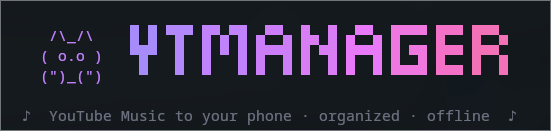
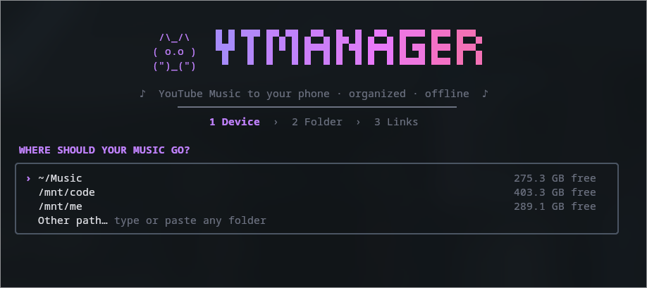
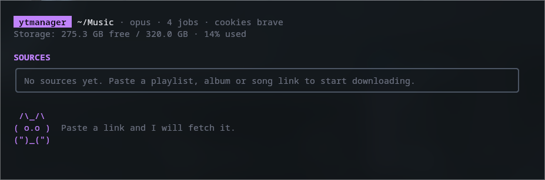
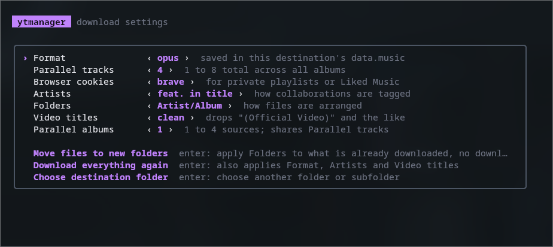

<p align="center">
  
</p>

<p align="center">
  <b>Your YouTube Music library, offline, organized, on any device.</b>
</p>

<p align="center">
  
  
  
</p>

ytmanager is a terminal app that downloads playlists, albums, mixes and songs from YouTube and
YT Music to a folder, a USB drive or straight to an Android phone, with clean tags, cover art,
lyrics and playlists that look right in any music player. It remembers what each destination
holds, so syncing again only downloads what is new.

## Screenshots

**Start screen**: pick a music folder, USB drive or phone.



**Sources**: paste a playlist, album or song link to start downloading.



**Settings**: format, parallel downloads, cookies, tagging and folder layout.



## Contents

- [Screenshots](#screenshots)
- [Features](#features)
- [Quick start](#quick-start)
- [Usage](#usage)
- [Managing your library](#managing-your-library)
- [Settings](#settings)
- [Troubleshooting](#troubleshooting)
- [Building from source](#building-from-source)
- [License](#license)

## Features

- **Paste a link and it downloads**: playlists, albums, mixes and songs from YouTube or YT Music.
- **Only what is new**: each destination remembers its songs, so syncing again skips them.
- **Folder, USB drive or Android phone** (MTP on Linux), detected automatically.
- **Clean tags**: album artist, year, track numbers, cover art and titles without
  "(Official Video)". Music videos are swapped for their YT Music audio track.
- **Lyrics** from [LRCLIB](https://lrclib.net) and YT Music, plus `.m3u8` playlists for every source.
- **Private playlists and Liked Music** using your browser's cookies.
- **Library tools**: search, find duplicates, delete, repair and reorganize folders.
- Pause, resume and queue more links while it downloads, with a cat keeping you company.

## Quick start

Requirements: [yt-dlp](https://github.com/yt-dlp/yt-dlp#installation) (keep it up to date),
[ffmpeg](https://ffmpeg.org/download.html) with `ffprobe`, and [Go](https://go.dev/dl/) 1.24+
to build. Android phones on Linux also need gvfs, which most desktops include.

```sh
# Arch / CachyOS
sudo pacman -S yt-dlp ffmpeg go
# Debian / Ubuntu
sudo apt install ffmpeg golang && pipx install yt-dlp
# macOS
brew install yt-dlp ffmpeg go
```

```sh
git clone https://github.com/MagusCat/ytmanager.git
cd ytmanager
go build -o ytmanager .
./ytmanager
```

## Usage

```sh
ytmanager            # choose a destination on the start screen
ytmanager ~/Music    # open a folder directly
```

1. **Pick where the music goes**: your music folder, a USB drive or a phone.
2. **Paste a link** (`ctrl+shift+v`). It starts right away; paste more to queue them.
3. **Next time**, open the same destination: `enter` continues pending downloads, `s` fetches new
   songs from your sources.

| Screen | Keys |
|---|---|
| Start | `↑↓` move · `enter` open · `e` edit path · `r` refresh · `q` quit |
| Folder browser | `→` open · `←` up · `n` new folder · `u` use this folder · `esc` back |
| Sources | `a` add · `enter` resume · `s` sync · `space` mark · `d` remove · `p` pause · `x` cancel · `l` library · `r` repair · `e` export M3U · `n` unavailable · `o` settings · `c` change folder · `q` quit |
| Library | `/` search · `f` duplicates · `s` scan files · `space` mark · `d` delete · `esc` back |
| Settings | `↑↓` move · `←→` change · `enter` run action · `esc` back |

In the library, deleting asks for confirmation and is permanent. Removing a source with `d`
keeps its files.

### Scripts and cron

```sh
ytmanager add    ~/Music <link>   # add a source and download it
ytmanager sync   ~/Music          # fetch new songs from every source
ytmanager resume ~/Music          # continue pending downloads
ytmanager repair ~/Music          # fix paths and rebuild playlists
```

Flags: `-format opus|m4a|mp3`, `-jobs 3`, `-albums 1`, `-cookies <browser>`.

### Output

```
Music/
├── data.music              # what ytmanager knows about this destination
├── Liked Music.m3u8
└── Bad Bunny/
    └── Un Verano Sin Ti/
        ├── 01 - Moscow Mule.opus
        └── 01 - Moscow Mule.lrc
```

## Settings

Press `o` on the sources screen. Settings are saved in `~/.config/ytmanager/config.json`; the
format is saved per destination.

| Setting | Options |
|---|---|
| Format | `opus` (best quality) · `m4a` (Apple) · `mp3` (old car stereos) |
| Parallel tracks / albums | 1–8 songs and 1–4 albums at once |
| Browser cookies | Needed for private playlists and Liked Music |
| Artists | `feat. in title` (default) · `main only` · `all in artist` |
| Folders | `Artist/Album/01 - Song` (default) · `Artist/Song` · `Artist - Song` |
| Video titles | `clean` (default) · `as uploaded` |

Actions in the same panel move existing files to a new folder layout or download everything
again with the new settings.

## Troubleshooting

| Problem | Fix |
|---|---|
| Liked Music shows 0 tracks | Set *Browser cookies* to a browser logged in to YouTube. |
| Downloads suddenly fail | Update yt-dlp: `yt-dlp -U`. |
| The phone does not appear | Unlock it, choose *File transfer*, press `r`. |
| A song is unavailable | Press `n` and paste another upload of it, or `r` to retry. |
| My player ignores the playlists | Press `e` to export `.m3u`, then rescan in the player. |

Android phones are supported on Linux only; on macOS and Windows download to a folder and copy it.

## Building from source

```sh
go build -o ytmanager .
go test ./...
```

See [CONTRIBUTING.md](CONTRIBUTING.md) for the project layout and how to add features.

## License

[MIT](LICENSE) © MagusCat

## Disclaimer

Download only content you have the right to download, and respect YouTube's Terms of Service and
the copyright laws of your country. This project is not affiliated with YouTube or Google.
